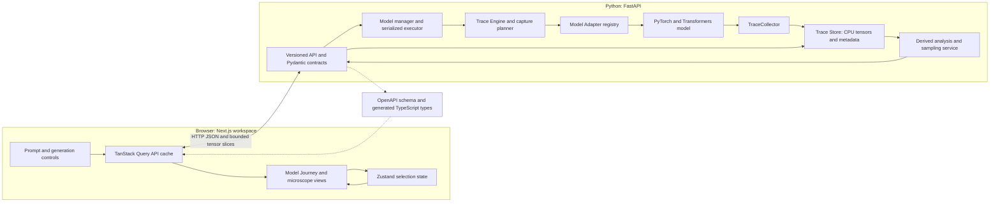
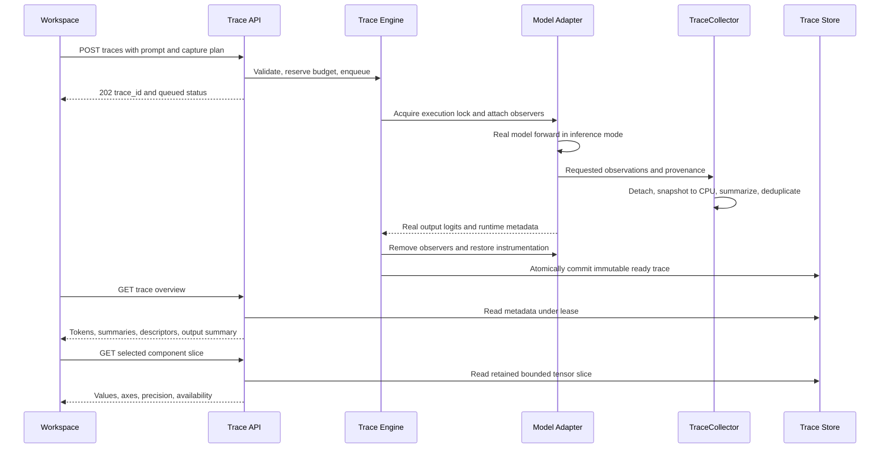
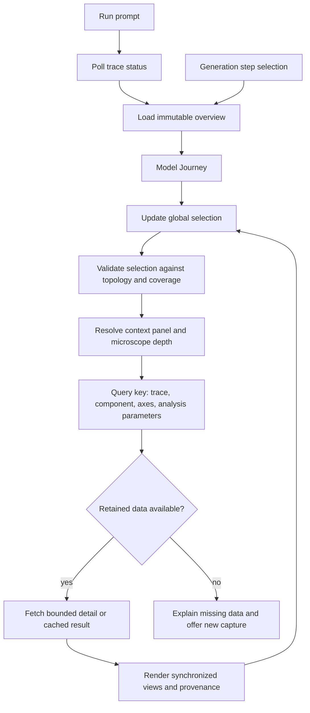

# System architecture

Status: Stage 0 blueprint with Stage 1 inference and Stage 2 in-process adapters/tracing implemented. The [Stage 2 report](validation/STAGE_2_REPORT.md) identifies measured evidence. Store, trace HTTP and visualization paths below remain future work.

## Decisions and boundaries

Use the requested Next.js / React / TypeScript / Tailwind CSS frontend and Python / FastAPI / PyTorch / Transformers / Pydantic backend. Model execution stays in Python. The browser renders semantic traces and changes selection; scientific transformations and sampling distributions are computed server-side.

The most important boundary is the **versioned semantic trace contract between model-specific execution and all visualizations**. A Trace Engine captures once, a Trace Store retains immutable CPU data, and every view asks for bounded portions of the same record. The frontend never uses Python module names or assumes a particular head width, layer count, normalization, or residual topology.

Begin as a local single-user application, with one resident model, one inference executor, and one ASGI worker. Keep inference off the asynchronous HTTP event loop. A serialized executor holds a model execution lock across loading, tracing, instrumentation, model-weight-dependent analyses, and interventions. This prevents overlapping hooks from contaminating runs and prevents model replacement during a vocabulary projection. Multiple web-server workers would each load weights and have separate in-memory stores; they are deliberately excluded until a shared execution/storage architecture exists.

## A. Complete system architecture



Arrows show responsibility and data movement, not sequential execution time. All scientific views share `trace_id` and component descriptors.

## Recommended future layout

```text
/
├── apps/
│   ├── web/
│   │   ├── src/app/                       # Next.js shell and routes
│   │   ├── src/features/                  # journey, layer, attention, etc.
│   │   ├── src/state/selection.ts         # linked selection and viewport
│   │   ├── src/lib/api/                   # typed client and query keys
│   │   └── tests/                         # interactions and browser checks
│   └── api/
│       ├── pyproject.toml
│       ├── src/llm_lab/
│       │   ├── main.py
│       │   ├── api/                       # v1 routes and error mapping
│       │   ├── schemas/                   # Pydantic contracts, authoritative
│       │   ├── models/                    # manager, devices, adapters/
│       │   ├── tracing/                   # engine, collector, capture plans
│       │   ├── storage/                   # trace store, leases, expiration
│       │   ├── analysis/                  # metrics, lens, projections
│       │   ├── generation/                # step executor and sampler
│       │   └── interventions/             # later controlled modifications
│       └── tests/                         # numerical, contract, lifecycle
├── packages/shared/
│   ├── openapi.json                       # generated API snapshot
│   └── src/generated/                    # generated TypeScript types
├── docs/                                  # current blueprint
└── README.md
```

This separates Python and JavaScript toolchains while sharing the contract, not runtime model code. Pydantic/OpenAPI is authoritative; do not hand-maintain a second TypeScript schema. A minimal npm workspace can manage `apps/web` and `packages/shared`; Python has its own environment and lockfile. No Nx/Turborepo, Docker, database, distributed queue, or chart collection is needed initially.

## Frontend responsibilities and libraries

| Choice | Purpose | Adoption boundary |
| --- | --- | --- |
| Next.js, React, TypeScript | Workspace shell and typed components | Stage 1 |
| Tailwind CSS | Consistent white-dominant layout and typography | Stage 1 |
| Zustand | One linked selection and viewport store | Stage 4 |
| TanStack Query | Status polling, trace cache, cancellation, lazy detail | Stage 3 |
| SVG / Canvas | Accessible architecture diagrams; dense heatmap rendering | Stages 4–5 |
| OpenAPI type generator | Prevent Python/TypeScript contract drift | Stage 1, expanded Stage 3 |
| scikit-learn; umap-learn | Server-side PCA; later UMAP | Stage 9 only |

React Flow is optional if graph editing/layout becomes materially complex; the fixed horizontal journey starts with custom SVG and DOM labels. Add D3 utilities or Plotly only for a specific demonstrated need. Add Three.js / React Three Fiber only for an approved later 3D scope. Avoid mounting a large visualization bundle for basic navigation.

Server state contains trace records, tensor descriptors, model status, and analysis results. Client state contains token/layer/head/component/candidate/step selection, visualization mode, viewport, and inspector depth. Never put large tensor arrays in Zustand or duplicate API data in it. Components query by trace identity and slice parameters.

## Backend responsibilities

- **API layer:** validate bounds, expose status, return summaries, resolve availability, enforce payload limits, and map structured errors. It does not know model module paths.
- **Model manager:** resolve revisions, own loading state, device/dtype and resident weights, execution lock, and baseline inference.
- **Model Adapter:** map modules to semantic operations, declare capabilities/topology, prepare model-specific instrumentation, and execute through the real model.
- **Trace Engine:** validate a capture plan, reserve memory, establish a run context, execute the adapter, finalize an immutable trace, and guarantee cleanup.
- **TraceCollector:** snapshot requested values and summaries without changing the forward computation; canonicalize axes and provenance.
- **Trace Store:** hold metadata and detached CPU tensors, deduplicate aliases, account bytes, expire records, and provide request leases.
- **Analysis service:** compute named metrics, vocabulary projections, sampling distributions, and later geometry/intervention comparisons from available data.

Adapter responsibilities can be expressed as `metadata`, `load_model`, `tokenize`, `forward`, `component_map`, `capabilities`, `prepare_instrumentation`, and `generate_step`. If an adapter exposes `trace`, it delegates orchestration to the Trace Engine; there must be no second per-view inference pipeline. `prepare_instrumentation` returns a context manager with run-scoped handles and cleanup.

## Verified Qwen3 structure

Structural inspection used official sources on 2026-10-07. The checkpoint's [configuration](https://huggingface.co/Qwen/Qwen3-0.6B/raw/main/config.json) reports:

| Property | Value |
| --- | --- |
| Decoder layers | 28, indexed 0–27 |
| Residual width `D` | 1,024 |
| Query heads `Hq`; KV heads `Hkv` | 16; 8 |
| Head width `d` | 128 |
| MLP intermediate width `I` | 3,072 |
| Vocabulary size `V` | 151,936 |
| Activation | SiLU |
| RMSNorm epsilon | 1e-6 |
| RoPE theta | 1,000,000 |
| Attention bias / dropout | false / 0.0 |
| Tied input/output embeddings | true |
| Sliding window | disabled |

The [model card](https://huggingface.co/Qwen/Qwen3-0.6B) lists a 32,768-token context, while config `max_position_embeddings` is 40,960. Preserve both facts in metadata rather than declaring either to be a proven tracing limit. Local capture limits below are much smaller. The card identifies Qwen3 support from Transformers 4.51.0 onward and describes chat-template thinking controls. Stage 1 must pin a currently compatible release and exact model/tokenizer revision; the checkpoint's historical `transformers_version` is not a dependency lock.

The [versioned Qwen3 implementation](https://raw.githubusercontent.com/huggingface/transformers/v4.51.3/src/transformers/models/qwen3/modeling_qwen3.py) defines sequential pre-normalized attention and gated MLP updates:

```text
r_in → RMSNorm → Q/K/V projections
Q/K → per-head RMSNorm → RoPE
Q,K,V → grouped-query causal attention → concatenation → output projection = attention update
r_mid = r_in + attention update
r_mid → RMSNorm → SiLU(gate projection) × up projection → down projection = MLP update
r_out = r_mid + MLP update
last r_out → final RMSNorm → LM head → logits
```

The [current implementation](https://raw.githubusercontent.com/huggingface/transformers/main/src/transformers/models/qwen3/modeling_qwen3.py) uses different output-capture and cache plumbing. The adapter must inspect and test the installed release rather than copy signatures from a historical tag. Neither source is vendored or executed during Stage 0.

### Adapter mapping and capture points

All paths in this table are Python adapter concerns. The canonical vocabulary is in [Trace design](TRACE_DESIGN.md).

| Qwen module / observation | Semantic component | Strategy |
| --- | --- | --- |
| `model.embed_tokens` output | `embedding.output` | Forward hook |
| `model.layers[i]` input/output | `layer[i].residual.before` / `.after_mlp` | Pre/forward hooks; handle tuple/tensor release differences |
| `input_layernorm` output | `layer[i].attention.input_normalized` | Forward hook |
| `self_attn.q_proj`, `.k_proj`, `.v_proj` outputs | `.attention.query.projected`, `.key.projected`, `.value` | Hooks and canonical reshape |
| `self_attn.q_norm`, `.k_norm` outputs | `.attention.query.normalized`, `.key.normalized` | Hooks; retain named head axes |
| Actual attention-function inputs | `.attention.query.rotary`, `.key.rotary`; mask, scale | Scoped observation wrapper for functional boundary |
| Actual attention-function output weights | `.attention.weights` | Eager output or scoped wrapper; capability-dependent |
| `self_attn.o_proj` input/output | `.attention.head_output` / `.concatenated` / `.output` | Pre/forward hooks, alias views |
| `post_attention_layernorm` input/output | `.residual.after_attention` / `.mlp.input_normalized` | Pre/forward hooks |
| `mlp.gate_proj`, `.up_proj` outputs | `.mlp.gate`, `.up` | Forward hooks |
| `mlp.down_proj` input/output | `.mlp.gated` / `.mlp.output` | Pre/forward hooks |
| SiLU result before product | `.mlp.activated_gate` | Functional observation if supported; otherwise a labeled derivation |
| `model.norm` input/output | `output.residual_final` / `output.normalized` | Hooks; separate pre-final-norm state |
| `lm_head` output | `output.logits` | Model output or forward hook; requested positions only |

Do not infer `d = D/Hq`: here `Hq*d` is 2,048, so query projection and concatenated head output are wider than the residual stream. GQA query head `h` uses KV head `floor(h/2)` for this configuration. K/V stay stored in their compact KV-head form. Q/K normalization precedes rotation; V has neither operation. RoPE is an attention positional transformation, not an additive token embedding.

Scores, masking, softmax, residual additions, and SiLU may be functional operations without ordinary module hooks. Capture actual boundaries where supported; otherwise derive from captured operands and label the method. Ordinary hooks alone do not expose every intermediate. A reconstructed attention matrix from a fused run is a derivation, not its captured attention weights. [Attention backend documentation](https://huggingface.co/docs/transformers/en/attention_interface) is a release-specific implementation reference.

## B. Inference and tracing data flow



Failures remove observers and release reservations before publishing a failed record. A slice read never initiates model inference. Selecting a component not retained offers a new capture request referencing the previous trace, without modifying it.

## C. Frontend interaction flow



`selectedToken` is an input position, `selectedCandidateToken` is a vocabulary ID, and neither is a token string. Generation selection resolves to a trace before dependent queries run. [Visualization workflow](VISUALIZATION_WORKFLOW.md) specifies reset and persistence rules.

## Device and execution policy

Auto selection tries available CUDA, then Apple MPS, then CPU; an explicit device choice overrides auto. CPU and MPS begin with float32 for a conservative scientific baseline. CUDA can use bfloat16 after capability checks, with a float32 reference path; float16 requires its own validation profile. MPS lower precision is enabled only after an explicit capability smoke test and numerical checks. Record effective choices and fallback reasons.

Use `eval()` and `torch.inference_mode()`, batch size 1, eager attention for the initial scientific trace path, and no KV cache until Stage 8. Disable compilation, quantization, remote model code, and kernel substitutions in the validated baseline. Fast fused attention can later become a separately validated mode. Switching backends changes execution provenance and requires a separate baseline comparison. A failed run never silently becomes a successful trace on another device.

Stage 1 implementation note: final-vocabulary softmax accumulates on CPU in float64 before returning float32 probabilities. The measured CPU float32-only normalization exceeded the scientific accuracy gate; the correction and exact discrepancy are recorded in [Scientific validation](SCIENTIFIC_VALIDATION.md). This output calculation does not change model execution or logits.

## Capture, memory, and latency budget

Lazy retrieval reduces network and browser work; it does not make backend capture free. Estimate retained bytes from each unique tensor's shape and storage dtype, plus transient attention scores, copy buffers, model weights, and allocator headroom. Deduplicate layer output / next layer input and view aliases. Do not retain autograd graphs, model outputs, or device tensors inside the Trace Store.

For full attention weights, bytes = `L * Hq * N² * bytes_per_element`, batch 1. Using the verified configuration yields these **capacity estimates, not measured benchmarks**:

| Sequence length | All-layer attention at 2 bytes | At 4 bytes |
| --- | --- | --- |
| 128 | 14 MiB | 28 MiB |
| 512 | 224 MiB | 448 MiB |
| 1,024 | 896 MiB | 1.75 GiB |
| 2,048 | 3.5 GiB | 7 GiB |

Eager execution may materialize full scores even when only selected heads are retained. Retention selection alone does not reduce its peak N² allocation. Avoid requesting all `output_attentions` when per-layer streaming capture suffices. Full-position logits cost `N * V * bytes`; at N=512 and float32 this is about 296.75 MiB. Keep last-position vocabulary logits by default and derive other positions on demand from retained final normalized states while the matching weights are available. Ordinary inference should request only necessary logits where the installed release permits it.

Proposed initial configurable limits: 128 input tokens by default, a hard initial trace limit of 512, 256 MiB retained bytes per trace, 512 MiB total retained trace bytes, 30-minute trace TTL, 65,536 elements per slice, and 1 MiB uncompressed JSON per response. These are policy starting points to calibrate against Stage 2 measurements, not hardware promises. Capture plans exceeding estimated budgets fail before execution with a smaller-plan suggestion. Do not silently truncate inputs or lower capture coverage.

Stage 2 applies the existing prompt limit and a 256 MiB default capture cap (`LLM_LAB_TRACE_MAX_BYTES`, configurable up to 1 GiB). It rejects a conservative extra-tensor peak estimate before registering any observer: estimated retained snapshots plus temporary capture/reconstruction/statistics work. The temporary estimate allows sixteen copies of selected operands, increased for a larger GQA grouping ratio. This includes float64 audit scratch and alias overestimation; it is a bound for instrumentation tensors, not model weights, the backend allocator or exact process RSS. Actual retained bytes count unique owned CPU storage. Summary releases per-layer temporary snapshots immediately after residual reconciliation. Selected detailed states survive only through reconstruction and validation, then the run releases its workspace. There is no Trace Store or aggregate trace/TTL policy yet.

Detailed Q/K/V variants and four MLP intermediates scale with sequence length and layers and can exceed attention storage for short prompts. GPU-to-CPU copies can synchronize execution; repeated tiny hooks add latency. Record capture overhead and peak accelerator/host memory separately. A browser must virtualize long layer/token lists and use Canvas for dense heatmaps rather than one React element per cell.

## Trace Store lifecycle and extensibility

Start with byte-accounted in-memory CPU storage behind an interface for reserve, commit, lease/read, delete, and expire. Store aliases by reference; keep reduced-precision copies explicit. Traces are immutable after commit. Expiration is absolute from completion; reads do not renew it. A request lease defers physical deletion until the read completes but does not make a trace immortal. Generation pins only the active records needed for execution; pinning still counts against the budget.

Later disk storage can implement the same interface using tensor blobs and a metadata index. Export/import requires a schema version, checksums, provenance, safe non-executable data formats, and import bounds. A recipe can recreate an expired trace but cannot restore its exact values without saved tensor data. Model-dependent derivations require the matching weights to remain resident or be explicitly loaded; store access alone must never trigger loading.

Additional adapters provide a semantic operation graph with ordered operations, named tensors, optional branches, residual topology, and capabilities. This accommodates LayerNorm, parallel residuals, gated/non-gated MLPs, sliding attention, or later MoE nodes without pretending every architecture is Qwen. Cross-model token/coordinate identities are incompatible by default. SAE feature views require separately identified feature models and evidence; placeholders are not activations.

## Principal risks and resolution gates

| Risk | Resolution before dependent features |
| --- | --- |
| Release-specific instrumentation and fused functional boundaries | Inspect pinned source; compare every observer path with baseline in Stage 2 |
| Capture mutates outputs, masks, cache, or module state | Serialized execution, observer-only hooks, exception cleanup, parity gates |
| Hidden-state tuple obscures final pre-normalized residual | Capture layer boundaries and final-norm input explicitly |
| GQA or head-width assumptions corrupt values | Named-axis assertions and configuration-derived dimensions |
| N² scores, large logits, deep linear captures | Preflight reservation, sequence limits, streaming copies, capture profiles |
| In-memory data disappears or concurrent reads race expiration | Typed unavailable/expired states and request leases |
| Interpretation overclaims | Provenance badges, formula context, human claim review |

The [validation plan](SCIENTIFIC_VALIDATION.md) defines experimental evidence. The [stages](IMPLEMENTATION_STAGES.md) specify when each gate must pass.
